<picture>
  <source media="(prefers-color-scheme: dark)" srcset="assets/hero-dark.svg">
  
</picture>

> [!TIP]
> **AI-assisted, human-reviewed.** I use AI coding tools to ship more, faster: scaffolding, refactors, debugging and documentation. Every change still gets my review before it lands.

> [!CAUTION]
> **Destructive actions get a checkpoint.** Problems I've run into made me careful with anything that can't be undone, like force-pushes, database migrations, bulk deletes and AI agents with shell access. I back up first, confirm the scope, then run.

<picture>
  <source media="(prefers-color-scheme: dark)" srcset="assets/parts-dark.svg">
  
</picture>

<picture>
  <source media="(prefers-color-scheme: dark)" srcset="assets/languages-dark.svg">
  
</picture>

<picture>
  <source media="(prefers-color-scheme: dark)" srcset="https://streak-stats.demolab.com?user=ianjohndal5&amp;card_width=840&amp;border_radius=6&amp;background=0B1A2E&amp;border=2E598C&amp;stroke=2B4A6F&amp;ring=58A6FF&amp;fire=79C0FF&amp;currStreakNum=E6EDF3&amp;sideNums=E6EDF3&amp;currStreakLabel=79C0FF&amp;sideLabels=8BA3C7&amp;dates=8BA3C7">
  
</picture>
